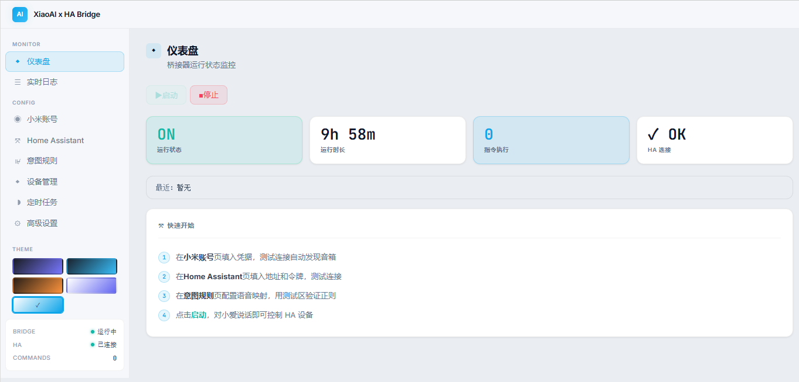
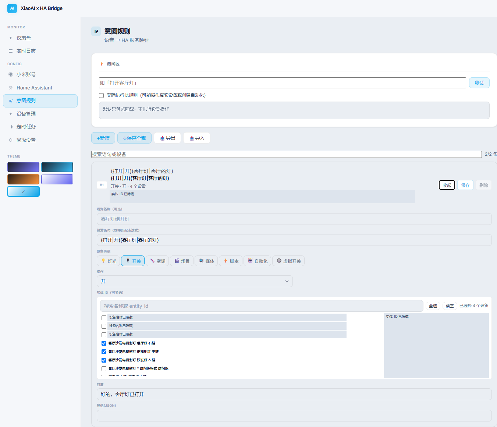
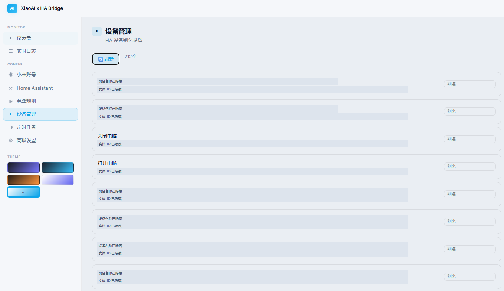
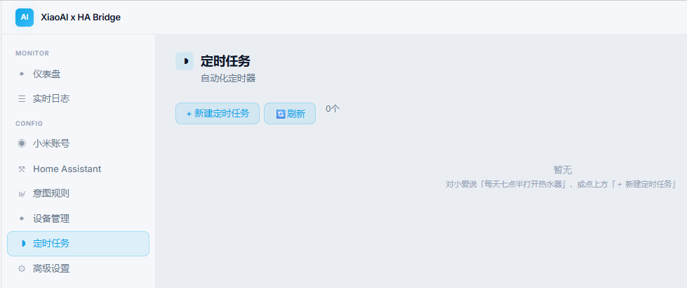

# XiaoAI HA Bridge

**让小爱音箱成为 Home Assistant 的语音入口。**

对音箱说「打开客厅灯」，灯就亮；说「把空调调到 26 度」，温度就跟着变。规则、定时任务、
音箱设置都在 Home Assistant 侧边栏的面板里点，不用写 YAML。

> 版本与更新记录见 [CHANGELOG](xiaoai_bridge/CHANGELOG.md) · 完整文档在 [docs/](docs/README.md) ·
> 这个加载项是 [chenshuhe/xiaoai-ha-bridge](https://github.com/chenshuhe/xiaoai-ha-bridge) 的
> Home Assistant OS 适配版。

---

## 能做什么

| 场景 | 说明 |
|---|---|
| 一句话控制设备 | 说「打开客厅灯」，桥接器把这句话换成 Home Assistant 的服务调用 |
| 一条规则控制多台 | 「全部关灯」一次关掉客厅、餐厅、走廊，规则里勾几个实体都行 |
| 带数字的指令 | 语句写 `把空调调到{num}度`，说 26 度就设 26 度（只支持整数） |
| 小爱回一句话 | 规则里填「回复」，执行完小爱念出来，也可以关掉 |
| 定时执行 | 说「明天八点打开热水器」「每周一三五晚上九点关灯」，或在面板里建任务 |
| 多台音箱都能用 | 默认监听账号下所有小爱设备，对哪台说话都算数 |
| 给设备起中文名 | 在设备管理里给实体起别名，规则里一眼能认出来 |

支持的设备类型：灯光、开关、空调、场景、媒体播放器、脚本、自动化、虚拟开关。
不同设备类型能用的操作不一样，面板会按类型给出对应选项。

## 需要什么

| 条件 | 说明 |
|---|---|
| Home Assistant OS | 本项是**加载项**，需要 Supervisor（HAOS，或带 Supervisor 的 Supervised 安装） |
| amd64 架构 | 目前只提供 amd64 镜像 |
| 小米账号和至少一台小爱音箱 | 音箱 / 触屏音箱 / 智能屏都是语音入口 |
| Home Assistant 长期访问令牌 | 面板里填一次，用来调用 HA 服务 |

不需要改 `configuration.yaml`，不需要装 HACS，也不需要把面板开放到公网。
米家的灯、插座、空调不在这里管理——它们由 Home Assistant 里对应的集成负责，
桥接器只负责「听音箱说的话」。

## 安装

1. Home Assistant → 设置 → 加载项 → 右上角 ⋮ → **仓库** → 粘贴
   `https://github.com/tarynwyj/xiaoai-ha-bridge-haos` → 添加。
2. 在加载项商店里找到 **XiaoAI HA Bridge** → 安装 → 启动。
3. 打开左侧边栏的 **小爱语音桥接**，用米家 App 扫码登录小米账号。
4. 在 Home Assistant 页填地址（例如 `http://homeassistant.local:8123`）和长期访问令牌，
   点「测试」，确认连接成功后点「保存」（只测试不会保存）。
5. 到意图规则页新增一条规则，保存后回仪表盘点「启动」。

然后对小爱说规则里的那句话，仪表盘的「指令执行」会加一。
详细步骤、直连端口备用法见 [安装与首次配置](docs/install.md)。

## 三条最常用的操作

**加一条语音规则**：意图规则页 → 新增 → 填触发语句、选设备类型和操作、勾选目标设备 →
点这一条的「保存」。规则页顶部可以先输入一句话试试会命中哪条、执行什么。

**建一个定时任务**：定时任务页 → 新建 → 选设备和操作、选时间与重复方式（每天 / 工作日 /
周末 / 自定义星期 / 仅一次指定日期）。也可以直接说「明天八点打开热水器」「十分钟后关灯」。
任务会写进 Home Assistant 的自动化，桥接器没在跑也会按时执行。

**限定听哪几台音箱**：小米账号页 →「接收语音的小爱音箱」→ 选「仅监听所选音箱」→ 勾选。
默认是全部。改完要重启桥接器生效。

更多写法见 [使用指南](docs/usage.md)。

## 界面

| 页面 | 用途 |
|---|---|
| 仪表盘 | 启动 / 停止桥接器、运行状态、指令执行数、最近一条语音 |
| 实时日志 | 最近的运行日志，排障先看这里 |
| 小米账号 | 登录小米、监听范围、设备参数、清除登录凭据 |
| Home Assistant | HA 地址与长期访问令牌 |
| 意图规则 | 语音 → 动作 → 设备，支持测试和导入导出 |
| 设备管理 | HA 实体列表与中文别名 |
| 定时任务 | 创建、编辑、暂停、清理定时任务 |
| 高级设置 | 轮询间隔、AI托管、直连令牌 |

截图已裁剪并遮挡账号数字、设备标识和部分私人名称。

意图规则：测试区、多设备选择与分条保存

设备管理：设备列表与别名

定时任务：新建入口与空列表

## 常见问题

**侧边栏看不到面板？** 确认加载项在运行；设置 → 加载项 → XiaoAI HA Bridge → 打开
「显示在侧边栏」。面板只对 Home Assistant 管理员显示。

**说了话没反应？** 先看仪表盘的「最近」有没有新语音。没有，是小米登录态或桥接器的问题；
有记录但设备没动，多半是规则没匹配上或实体 ID 不对，用规则页测试区验证。

**一定要扫码吗？** 不是。也可以用账号密码 + 验证码，或手动填 Cookie。扫码最稳，其余方式
容易卡在小米的验证上，具体见 [登录小米账号](docs/login.md)。

**提示 `code=70016` 怎么办？** 这张 Cookie 票已经失效。在浏览器里退出小米账号、重新登录，
复制新的 `userId` 和 `passToken` 再试；还不行就用面板里的「浏览器代签」。

**直连端口要令牌？** `http://<主机IP>:47521` 需要直连令牌，在面板「高级设置 → 显示直连令牌」查看。
日常建议直接用侧边栏。

**升级会不会丢配置？** 不会，配置和登录凭据都在 `/data`。升级前建议做一次 HA 备份，
回退步骤见 [升级与回退](docs/upgrade.md)。

还有别的症状，看 [故障排查](docs/troubleshooting.md)。

## 文档

| 文档 | 内容 |
|---|---|
| [docs/README.md](docs/README.md) | 文档目录，按你的目标选一篇 |
| [安装与首次配置](docs/install.md) | 装加载项、登录小米、连接 HA、第一条规则 |
| [使用指南](docs/usage.md) | 规则写法、定时任务、多台音箱、AI 托管 |
| [登录小米账号](docs/login.md) | 四种登录方式、70016、自动续期、清除凭据 |
| [故障排查](docs/troubleshooting.md) | 按症状查：面板、语音、定时任务、登录 |
| [数据与隐私](docs/data-and-privacy.md) | 数据存在哪、发往哪里、备份注意 |
| [升级与回退](docs/upgrade.md) | 升级、回退、版本对应关系 |
| [xiaoai_bridge/DOCS.md](xiaoai_bridge/DOCS.md) | 加载项页面里的「文档」页（HA 内查看） |
| [DEVELOPMENT.md](DEVELOPMENT.md) | 补丁构建、测试、CI、发布（开发者） |

## 数据与隐私

配置、登录凭据、日志都在 `/data` 下，不会上传给作者或第三方。运行时必须与小米服务端
通信（登录、拉取对话记录），也会和你填写的 Home Assistant 通信。开启「AI托管」时，
语音文本会额外发给你配置的 AI 接口，默认关闭。

`/data` 会随 Home Assistant 备份一起备份，**备份文件里含凭据**，请自己保管。
面板走 HAOS Ingress，只对管理员可见；直连端口是明文 HTTP，只在可信局域网用。
细节和完整数据流向见 [数据与隐私](docs/data-and-privacy.md)。

## 支持范围与已知限制

- 只发布 **amd64** 镜像，需要 Home Assistant OS（或带 Supervisor 的安装）；
- 语音识别和对话记录由小米提供，小米服务不可用时桥接器无法工作；
- 扫码登录是主要方式。账号密码 + 验证码流程只通过模拟回归测试，真实账号尚未验证；
  邮箱验证码（小米返回 `flag=8`）只识别、不发送，会提示改用扫码；
- 手动 Cookie 登录已实测可用（浏览器重新登录后取新票），被拒时先换票再考虑「浏览器代签」；
  「浏览器代签」目前只通过模拟回归测试，真实账号行为需要自测；
- 直连端口为明文 HTTP，跨网段或公网请用侧边栏面板。

## 许可与鸣谢

本仓库原创代码与文档采用[自定义非商业许可](LICENSE)：非商业使用免费，商业使用需事先
取得书面授权。上游核心桥接逻辑来自
[chenshuhe/xiaoai-ha-bridge](https://github.com/chenshuhe/xiaoai-ha-bridge)，
构建所用固定提交的 README 声明为 MIT；授权范围与第三方说明见
[THIRD_PARTY_NOTICES.md](THIRD_PARTY_NOTICES.md)。

感谢上游作者与所有反馈问题的用户，其中 **[@caideone](https://github.com/caideone)**
定位并修复了小爱对话轮询丢失认证 Cookie 的问题（PR #4）。

---

English summary

**XiaoAI HA Bridge** — control Home Assistant from a Xiaomi XiaoAI speaker. It runs as a
Home Assistant OS add-on, opens from the sidebar (HAOS Ingress), and maps spoken phrases to
Home Assistant service calls with a visual rule editor: multi-entity actions, aliases,
scheduled automations and TTS replies.

Install: add `https://github.com/tarynwyj/xiaoai-ha-bridge-haos` as an add-on repository,
install **XiaoAI HA Bridge**, open the sidebar panel, log in to Xiaomi, fill in your Home
Assistant URL and long-lived token, add intent rules, then start the bridge.

User docs (Chinese): [docs/](docs/README.md) · Developer docs: [DEVELOPMENT.md](DEVELOPMENT.md).

